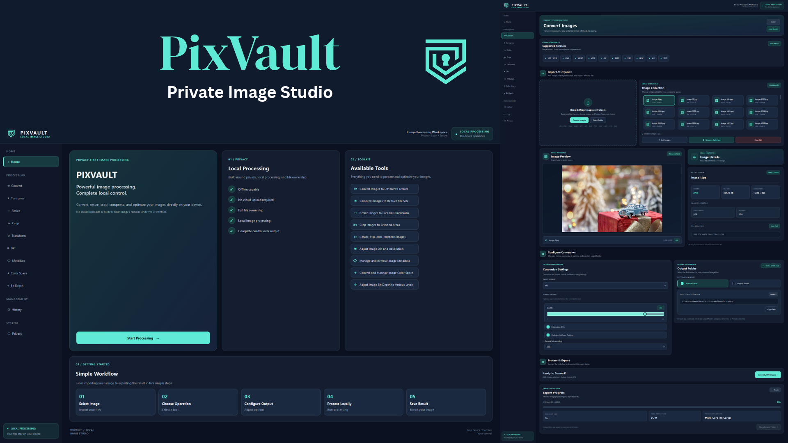

# PixVault — Private Image Studio

[-0078D6?logo=windows&logoColor=white)](https://www.microsoft.com/windows)
[](https://www.python.org/)
[-41CD52?logo=qt&logoColor=white)](https://wiki.qt.io/Qt_for_Python)
[](https://python-pillow.org/)
[](#tech-stack)
[](#tech-stack)
[](https://pyinstaller.org/)
[](#data-storage--synchronization)
[](#project-description)
[](./LICENSE)

<p align="center">
  
</p>

PixVault is a high-performance, privacy-first desktop image processing and optimization studio engineered for 64-bit Windows environments. Built with Python 3 and PySide6 (Qt 6), PixVault provides photographers, web developers, graphic artists, and privacy-conscious users with an entirely local, zero-telemetry image engineering workstation.

Rooted in the core operational principle that *user images must never leave the local device*, PixVault serves as a secure, local alternative to cloud-based image converters. The application focuses strictly on technical image processing rather than cosmetic raster editing—specializing in high-throughput multi-format conversion, quality-calibrated compression, multi-algorithm dimension scaling, precision cropping, orthogonal and free-angle transformations, DPI print density configuration, sensitive metadata stripping, ICC color profile translation, and bit-depth quantization.

To eliminate the performance bottlenecks and UI freezes typical of sequential batch operations, PixVault integrates a multi-process architecture (`concurrent.futures.ProcessPoolExecutor`) that automatically detects the host machine's logical CPU core topology to distribute encoding and decoding tasks across isolated child processes, completely bypassing Python's Global Interpreter Lock (GIL). An asynchronous Qt worker thread coordinates job submission, progress signals, and collision-free output routing, ensuring a fluid 60 FPS user experience even when batch-processing thousands of high-resolution image assets.

---

## Features

- **Hardware-Adaptive Multi-Core Parallel Engine**:
  - **Dynamic CPU Core Topology**: Inspects available logical processor cores (`os.cpu_count()`) to allocate an optimal worker pool, maximizing image processing throughput across all system cores.
  - **Process-Level GIL Bypass**: Executes compute-heavy image decoders, transformations, and encoders inside dedicated child worker processes (`ProcessPoolExecutor`), preventing Python's Global Interpreter Lock from blocking the application.
  - **Non-Blocking UI Thread Orchestration**: A dedicated `WorkerThread` (`QThread`) bridges background worker processes and the PySide6 interface via thread-safe Qt signals (`progress_changed`, `processing_finished`, `processing_error`).
  - **Instant Cancellation & Cleanup**: Provides clean execution abortion, terminating child processes (`proc.terminate()`) and shutting down thread pools without leaving orphan processes or locked temporary files.
  - **High-Speed Collision-Free Path Allocation**: Fast directory pre-scanning via `os.scandir` alongside an in-memory collision resolution engine (`NamingEngine`) that prevents disk write conflicts before workers begin execution.

- **Universal Multi-Format Encoding & Codec Ecosystem**:
  - **JPEG / JPG**: Continuous quality slider (1–100), baseline vs. Progressive JPEG encoding, Huffman code optimization, and configurable Chroma Subsampling (`4:2:0`, `4:2:2`, `4:4:4`).
  - **PNG**: Zlib compression level calibration (0–9), optimize flag, full alpha transparency preservation, and 8-bit / 16-bit channel support.
  - **WebP**: Native Google WebP encoding supporting both bit-exact Lossless and perceptual Lossy modes with compression effort tuning (methods 0–6).
  - **AVIF**: Next-generation AV1 image format encoding with quality and speed trade-off controls via `pillow-avif-plugin`.
  - **HEIC / HEIF**: High-efficiency container decoding and encoding powered by `pillow-heif` and bundled native C++ libraries (`libheif`, `libde265`, `libx265`).
  - **TIFF / TIF**: Professional prepress multi-channel support with compression algorithms (None, LZW, Deflate, PackBits) and precision depths up to 32-bit floating point via `tifffile`.
  - **BMP & GIF**: Standard Windows uncompressed bitmap generation and animated/static GIF quantization with dither controls.
  - **Windows Icon (ICO)**: Multi-resolution icon generation embedding standard dimensions (16×16, 32×32, 48×48, 64×64, 128×128, 256×256) into a single `.ico` container.
  - **SVG Vector Handling**: Two-way vector workflows—rasterizing input SVGs via Qt's `QSvgRenderer` and encapsulating raster images into vector SVG containers via `svgwrite`.
  - **Camera RAW Ingestion**: Direct ingestion and demosaicing of professional digital camera digital negatives (`.raw`, `.cr2`, `.nef`, `.arw`) via `rawpy` (LibRaw bindings).

- **Technical Image Processing Pipeline**:
  - **Dimension Resizing (`ImageResizer`)**: Dimensional scaling by Width, Height, Fit, Percentage, or Exact dimensions with aspect ratio locking. High-fidelity interpolation algorithms include Lanczos, Bicubic, Bilinear, Box, Hamming, and Nearest Neighbor.
  - **Geometric Cropping (`ImageCropper`)**: Preset aspect ratios (1:1 square, 4:3, 16:9, etc.), center percentage cropping, and custom pixel-coordinate bounding box clipping (`X`, `Y`, `Width`, `Height`).
  - **Affine Transformation (`ImageTransformer`)**: Lossless orthogonal rotations (90°, 180°, 270°), arbitrary angle rotations with edge handling, and horizontal / vertical mirroring flips.
  - **Quality & Size Compression (`ImageCompressor`)**: Perceptual quality calibration and target byte-budget compression profiles.
  - **Print Density Calibration (`DPIProcessor`)**: Physical print density specification in DPI (Dots Per Inch) or DPCM (Dots Per Centimeter) across 72, 150, 300, and 600 print standards with linked or independent axis configuration.
  - **Privacy Metadata Sanitization (`MetadataProcessor`)**: Complete stripping of Exif tags, GPS latitude/longitude coordinates, camera hardware serials, lens parameters, author copyright, and embedded XMP/IPTC metadata blocks.
  - **ICC Color Space Management (`ColorSpaceProcessor`)**: International Color Consortium (ICC) color transformation powered by bundled ICC profiles (`sRGB`, `AdobeRGB1998`, `DisplayP3`, `FOGRA39` CMYK, and `Gray`) with selectable rendering intents (Perceptual, Relative Colorimetric, Saturation, Absolute Colorimetric).
  - **Precision Bit-Depth Quantization (`BitDepthProcessor`)**: Precision conversions across 8-bit, 16-bit, and 32-bit channels (for PNG and TIFF) with floating-point normalization.

- **Obsidian Dark Navy UI & Interactive Workspace**:
  - **Tailored Modern Theme**: Custom Qt Style Sheets (QSS) featuring a dark navy palette (`#0B1120`, `#141E30`, `#1B2940`) accentuated with glowing emerald status indicators (`#5EEAD4`) and high-contrast typography (`#F1F5F9`).
  - **Interactive Drag-and-Drop Surface**: Custom drop zone accepting files and entire folder trees directly from Windows File Explorer.
  - **Live Image Inspector & Preview**: Instant visualization of loaded assets with real-time metadata readouts (format, resolution, bit-depth, file size, color space).
  - **Real-Time Batch Telemetry**: Progress indicator showing overall completion percentage, currently processed filename, completed file counters, and active multi-core engine status.
  - **Flexible Destination Routing**: Instant toggle between default workspace export (`Pictures\PixVault Export`) and custom user-specified directory targets.

- **Local Audit Center & Execution History**:
  - **Local JSON History Store**: Persistent tracking of all processing jobs saved locally to `history/history.json` (or `%APPDATA%\PixVault\history.json` in frozen builds).
  - **Granular Record Tracking**: Stores UUIDv4 identifiers, timestamps, input paths, output paths, target formats, applied operations, execution statuses (`success` / `failed`), and error stack traces.
  - **Interactive Management UI**: Real-time search filtering across history records, detailed operation inspection, individual record deletion, and single-click history wiping.

- **Absolute Zero-Network Privacy Architecture**:
  - **Air-Gapped Operation**: Completely functional without an active internet connection.
  - **Zero Telemetry & Analytics**: No third-party SDKs, tracking beacons, error report uploads, or phone-home requests.
  - **Non-Destructive Processing**: Source images are strictly opened in read-only mode and never altered in place.

---

## Preview & Demo

### Home Dashboard & Feature Overview

<p align="center">
  
</p>

_The primary application landing interface: Highlights the privacy-first local architecture, available technical tools (Convert, Compress, Resize, Crop, Transform, DPI, Metadata, Color Space, Bit Depth), and the structured 5-step processing workflow._

---

### Main Conversion Studio & Asset Queue

<p align="center">
  
</p>

_The main conversion studio loaded with a 2,000-image batch: Features the Drag & Drop import zone, scrollable image collection grid, real-time image preview display, technical image inspector (showing format, file size, resolution, color mode, and bit depth), and the multi-core processing engine indicator._

---

### Format Conversion & Encoder Configuration

<p align="center">
  
</p>

_Fine-grained format conversion workspace: Displays the 10 supported output formats, JPEG quality calibration slider, Progressive encoding toggle, Huffman code optimization, Chroma Subsampling selector, and output folder destination routing._

---

### High-Precision Dimension Resizing

<p align="center">
  
</p>

_The image resizing module: Demonstrates dimension configuration by Width, Height, Fit, Percentage, or Exact dimensions, aspect ratio constraint locking, and resampling algorithm selection (Lanczos, Bicubic, Bilinear, Nearest Neighbor)._

---

### Print Resolution & DPI Calibration

<p align="center">
  
</p>

_Print resolution tuning interface: Configures print density in DPI or DPCM (72, 150, 300, 600 DPI) across supported formats (JPEG, PNG, TIFF) with linked or unlinked horizontal and vertical resolution controls._

---

### ICC Color Space Transformation

<p align="center">
  
</p>

_Professional color management interface: Translates image color profiles across sRGB, Adobe RGB (1998), Display P3, FOGRA39 CMYK, and Grayscale with selectable rendering intents (Perceptual, Relative Colorimetric, Saturation, Absolute Colorimetric)._

---

### Local Processing History & Activity Audit

<p align="center">
  
</p>

_The local activity audit center: Displays 2,000 completed batch execution records, real-time search filtering, and granular detail inspection including source paths, output locations, applied pipeline operations, and execution timestamps._

---

### Privacy Architecture & Local Lifecycle Guarantee

<p align="center">
  
</p>

_The privacy system panel: Details the air-gapped file lifecycle (Select → Process → Clean Up → Export), local-only data retention, and zero-telemetry architectural guarantees._

---

## Platform Support

| Dimension | Specification | Verification Source |
| :--- | :--- | :--- |
| **Primary Operating System** | Windows 10, Windows 11 | `PixVault.spec`, `version_info.txt`, PySide6 Windows platform plugin |
| **Target CPU Architecture** | x64 (64-bit AMD64 / Intel 64) | PyInstaller PE binary compilation & 64-bit Python runtime |
| **Configured Targets** | Windows (x64) | PyInstaller build script, Windows PE version metadata |
| **Tested Targets** | Windows 11 (x64), Windows 10 (x64) | Headless smoke test validation (`--selftest`), 2,200+ batch test records |
| **Published Distribution** | Standalone Executable (`dist/PixVault.exe`) | PyInstaller single-file binary bundle (~82 MB) |

---

## Tech Stack

### Core Runtime & Languages
- **Python 3.10+** (tested through Python 3.15 64-bit): Core application execution runtime.
- **PySide6 (Qt 6 for Python)**: Native Windows desktop GUI framework utilizing Qt Widgets, `QThread` concurrency, `QSvgRenderer`, and custom Qt Style Sheets (QSS).

### Image Processing & Codec Engines
- **Pillow (PIL 10+)**: Fundamental image manipulation, format decoding, and encoding backend.
- **NumPy**: High-performance multi-dimensional array operations for pixel-level data handling.
- **pillow-heif**: Apple HEIC / HEIF image container decoding and encoding with embedded native C++ dynamic libraries (`libheif.dll`, `libde265.dll`, `libx265.dll`).
- **pillow-avif-plugin**: High-efficiency AVIF format encoding and decoding.
- **tifffile**: Scientific and prepress TIFF read/write engine supporting 16-bit and 32-bit floating-point bit depths.
- **rawpy**: Professional digital camera RAW image demosaicing via LibRaw C++ bindings.
- **svgwrite**: Vector SVG container serialization and packaging.

### Concurrency & Performance
- **concurrent.futures.ProcessPoolExecutor**: Multi-core parallel process management bypassing the Python Global Interpreter Lock (GIL).
- **multiprocessing.freeze_support**: Safe subprocess spawning support for frozen PyInstaller Windows executables.
- **PySide6.QtCore.QThread**: Decoupled asynchronous worker thread preventing GUI freezes during long-running batch operations.

### Color Management & Prepress
- **LittleCMS / PIL.ImageCms**: Full ICC profile color space conversion engine.
- **Bundled ICC Profiles**: `sRGB.icc`, `AdobeRGB1998.icc`, `DisplayP3.icc`, `FOGRA39.icc` (CMYK), and `Gray.icc`.

### Persistence & Packaging
- **Local JSON Database**: File-based audit logging stored in `history/history.json` or `%APPDATA%\PixVault\history.json`.
- **PyInstaller 6+**: Standalone single-file Windows executable packaging (`PixVault.spec`).

---

## Prerequisites

### For End-Users
- **Operating System**: Windows 10 or Windows 11 (64-bit x64).
- **Hardware**: Standard 64-bit multi-core CPU, minimum 4 GB RAM (8 GB+ recommended for large batch processing).
- **Dependencies**: None. The pre-built standalone executable (`PixVault.exe`) bundles all required Python runtimes, Qt libraries, and codec DLLs.

### For Developers
- **Python**: Python 3.10 or higher (64-bit).
- **Package Manager**: `pip` (v23+ recommended).
- **Toolchain**: Microsoft Visual C++ 2015–2022 Redistributable (x64) for compiled C extensions.
- **Virtual Environment**: Standard `venv` or `virtualenv`.

---

## Installation & Setup

### For End-Users (Standalone Executable)

1. Obtain the pre-built `PixVault.exe` executable from the project release or the `dist/` directory:
   ```powershell
   dist\PixVault.exe
   ```
2. Double-click `PixVault.exe` to launch the application immediately. No installer or Python environment required.

---

### For Developers (Source Code Setup)

1. **Clone the Repository**:
   ```bash
   git clone https://github.com/weztcy/PixVault---Private-Image-Studio.git
   cd "PixVault---Private-Image-Studio"
   ```

2. **Create and Activate a Virtual Environment**:
   ```powershell
   python -m venv .venv
   .\.venv\Scripts\Activate.ps1
   ```

3. **Install Dependencies**:
   ```bash
   pip install --upgrade pip
   pip install -r requirements.txt
   ```

4. **Verify Environment Setup**:
   ```powershell
   python main.py --selftest
   ```

---

## Environment Variables & Configuration

PixVault is an air-gapped, local-first utility requiring **no API keys, tokens, or cloud secrets**.

### Runtime Storage Paths

| Path Target | Development Environment | Frozen Executable (`PixVault.exe`) | Description |
| :--- | :--- | :--- | :--- |
| **Audit History** | `history/history.json` | `%APPDATA%\PixVault\history.json` | Persistent record of processed batches |
| **ICC Profiles** | `processing/profiles/` | Bundled in `_MEIPASS/processing/profiles` | Standard ICC color profiles |
| **Default Export** | `~\Pictures\PixVault Export` | `~\Pictures\PixVault Export` | Default destination for processed images |

---

## Usage / Getting Started

### Launching the Application

- **Via Python Interpreter**:
  ```powershell
  python main.py
  ```
- **Via Standalone Binary**:
  ```powershell
  .\dist\PixVault.exe
  ```

---

### Step-by-Step Workflow

1. **Import Source Images**:
   - Navigate to the **Convert** page or any technical processing tool via the sidebar.
   - Drag and drop image files or folders onto the drop area, or use the **Browse Images** / **Select Folder** buttons.
2. **Inspect Assets**:
   - Click any thumbnail in the **Image Collection** list to view the full-resolution preview and review technical metadata (format, dimensions, file size, color depth).
3. **Select Processing Tool**:
   - Choose a specialized operation from the sidebar navigation:
     - **Convert**: Format conversion across 10 formats.
     - **Compress**: Lossy and lossless quality compression.
     - **Resize**: Dimension scaling with Lanczos / Bicubic interpolation.
     - **Crop**: Aspect ratio clipping and custom coordinate framing.
     - **Transform**: Rotation and horizontal/vertical flipping.
     - **DPI**: Print resolution calibration (72, 150, 300, 600 DPI).
     - **Metadata**: Exif and GPS privacy stripping.
     - **Color Space**: ICC profile translation (sRGB, Adobe RGB, Display P3, CMYK).
     - **Bit Depth**: 8-bit, 16-bit, and 32-bit channel quantization.
4. **Configure Parameters**:
   - Adjust quality sliders, compression modes, or color space rendering intents.
5. **Set Output Destination**:
   - Keep the default export directory (`Pictures\PixVault Export`) or toggle **Custom Folder** to select a dedicated output location.
6. **Execute Processing**:
   - Click the primary action button (e.g., **Convert Images**).
   - Watch the multi-core progress bar display real-time completion status and per-file progress.
7. **Review Activity**:
   - Navigate to **History** in the sidebar to review completed operations, filter records, or inspect output file paths.

---

## Available Scripts / Commands

| Command | Environment | Description |
| :--- | :--- | :--- |
| `python main.py` | Python 3.10+ | Launches the full PySide6 desktop GUI application |
| `python main.py --selftest` | Python 3.10+ / EXE | Executes headless smoke test suite validating ICC profiles, codecs, pipeline, and multiprocessing |
| `python tools/make_icon.py` | Python 3.10+ | Regenerates multi-size Windows `.ico` asset (`icons/pixvault.ico`) and high-res icon PNG |
| `python tools/capture_pages.py` | Python 3.10+ | Headless automated script capturing full-resolution screenshots of all 12 workspace pages |
| `packaging\build.bat` | Windows Shell | Automated build script that generates application icons and compiles `dist\PixVault.exe` via PyInstaller |
| `pyinstaller --clean --noconfirm PixVault.spec` | PyInstaller 6+ | Compiles the standalone single-file Windows executable |

---

## Permissions & Device Requirements

- **Filesystem Read Permission**: Required to access user-selected input images across local and removable storage drives.
- **Filesystem Write Permission**: Required to export processed image files to the target destination folder and update the local audit history database (`history.json`).
- **Multi-Core CPU Subprocess Spawning**: Requires standard OS permission to spawn child worker processes via `multiprocessing` for parallel encoding.
- **Network Permissions**: **None**. PixVault does not bind to local network sockets or make outbound HTTP/HTTPS requests.

---

## Data Storage & Synchronization

### Local Audit Persistence
All batch processing activities are logged locally to a human-readable JSON database (`history/history.json` or `%APPDATA%\PixVault\history.json`). Each record contains:
- `id`: Unique UUIDv4 identifier.
- `timestamp`: Formatted execution date and time (`YYYY-MM-DD HH:MM:SS`).
- `source`: Absolute path to the source image file.
- `output`: Absolute path to the generated output file.
- `format`: Output file format identifier.
- `operations`: List of applied pipeline operations and parameters.
- `status`: Execution outcome (`success` or `failed`).
- `error`: Exception message and failure traceback (if applicable).

### Collision-Free Naming Architecture
The `NamingEngine` module automatically handles filename collisions when exporting images into directories with existing files. Before processing begins, the engine scans the destination directory, pre-allocates target paths, and appends clean sequential suffixes (e.g., `_01`, `_02`) to guarantee that existing user files are never overwritten accidentally.

### Cloud Synchronization
PixVault has **no cloud synchronization capabilities**. All processing, caching, and history storage reside exclusively on the host computer's local filesystem.

---

## Testing

PixVault includes a dedicated headless self-test suite built directly into `main.py`. This test suite can be run directly from source or against the frozen PyInstaller binary to verify runtime integrity without launching the graphical desktop interface.

### Running the Headless Smoke Test

```powershell
python main.py --selftest
```

Or on the compiled binary:

```powershell
.\dist\PixVault.exe --selftest
```

### Verified Test Subsystems

1. **ICC Profile Loader**: Confirms that bundled ICC profiles (`sRGB.icc`, `AdobeRGB1998.icc`, `DisplayP3.icc`, `FOGRA39.icc`, `Gray.icc`) load correctly from filesystem or frozen package datas.
2. **HEIF Plugin Registration**: Validates that `pillow-heif` registers successfully with PIL and that the HEIF encoder is operational.
3. **AVIF Plugin Registration**: Validates that `pillow-avif-plugin` registers the AVIF encoder with PIL.
4. **Image Pipeline Execution**: Instantiates an in-memory test image, applies DPI scaling and metadata sanitization, and verifies valid output creation.
5. **Multi-Core Process Pool**: Executes parallel batch processing across 4 concurrent test tasks using `BatchWorker` and asserts 100% success output.

Test results are logged to the console and saved to `%TEMP%\pixvault_selftest.txt`.

---

## Build & Packaging

PixVault is packaged into a self-contained, single-file Windows executable (`PixVault.exe`) using PyInstaller and the project specification file `PixVault.spec`.

### PyInstaller Bundling Architecture

- **Windowed Executable (`console=False`)**: Suppresses the Windows command prompt console window.
- **Data Bundling**: Embeds ICC profiles (`processing/profiles/`) and application branding (`icons/pixvault_icon.png`) into the executable bundle.
- **Native Binary Detection**: Automatically discovers and bundles native C++ dynamic link libraries required for HEIC and AVIF decoding (`libheif*.dll`, `libde265*.dll`, `libx265*.dll`, `_pillow_heif*.pyd`).
- **Windows PE Version Information**: Embeds standard Windows executable metadata (Company Name, Product Name, File Version `1.0.0`, Description) from `packaging/version_info.txt`.
- **Application Icon**: Links the multi-resolution application icon `icons/pixvault.ico`.

### Compiling the Standalone Executable

Run the automated build script:

```powershell
.\packaging\build.bat
```

Or invoke PyInstaller manually:

```powershell
python tools\make_icon.py
python -m PyInstaller --clean --noconfirm PixVault.spec
```

The resulting executable is generated at:
```
dist\PixVault.exe
```

---

## License

Please see the [LICENSE](./LICENSE) file for the terms and conditions governing the use, modification, and distribution of this project.

## Author & Contact

**Yohanes Dimas Pratama**

- GitHub: [github.com/weztcy](https://github.com/weztcy)
- Portfolio: [dimaspratama.vercel.app](https://dimaspratama.vercel.app)
- LinkedIn: [linkedin.com/in/yohanes-dimas](https://www.linkedin.com/in/yohanes-dimas)

